

  <a href="https://visual-ai.app">
    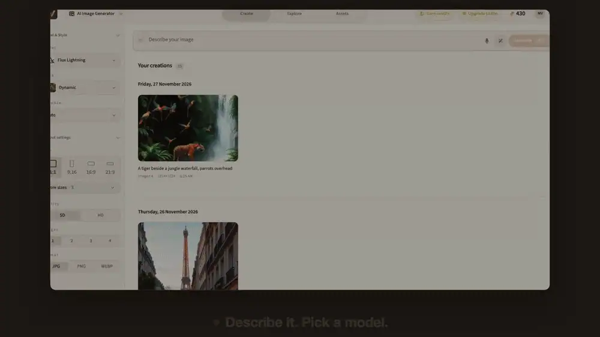
  </a>

<a href="#demo-video">Watch the full demo (MP4)</a>

<!-- DEMO_MP4: drag demo.mp4 here on GitHub -->

  

<h3 align="center">Visual AI</h3>

  Text to image with 20 models, plus photo tools to upscale, colorize, restore and cut out backgrounds. 
  <a href="https://visual-ai.app"><strong>Try it live at visual-ai.app »</strong></a>

  
  
  
  

  
  
  
  
  
  
  

  <a href="#feature-tour"><strong>Features</strong></a> ·
  <a href="#tech-stack"><strong>Tech Stack</strong></a> ·
  <a href="#architecture"><strong>Architecture</strong></a> ·
  <a href="#notable-engineering-decisions"><strong>Engineering</strong></a> ·
  <a href="#roadmap"><strong>Roadmap</strong></a> ·
  <a href="#contact"><strong>Contact</strong></a>

## Feature tour

### Create

Describe an image, pick a model, generate. 20 image models from Flux, Pruna, xAI, ByteDance, Google and OpenAI run through [Replicate](https://replicate.com). Half cost 1 credit per image and the other half cost 5. Options include aspect ratio, output format, 1K/2K/4K resolution, reference images and 15 style presets. Progress streams live while the job runs.

  <a href="https://visual-ai.app/create">
    <picture>
      <source media="(prefers-color-scheme: dark)" srcset="docs/assets/readme/create-dark.webp">
      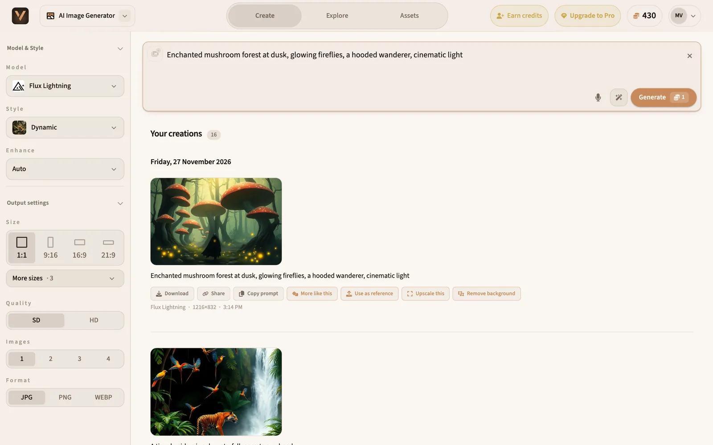
    </picture>
  </a>

<table align="center">
  <tr>
    <td width="50%" valign="top">
      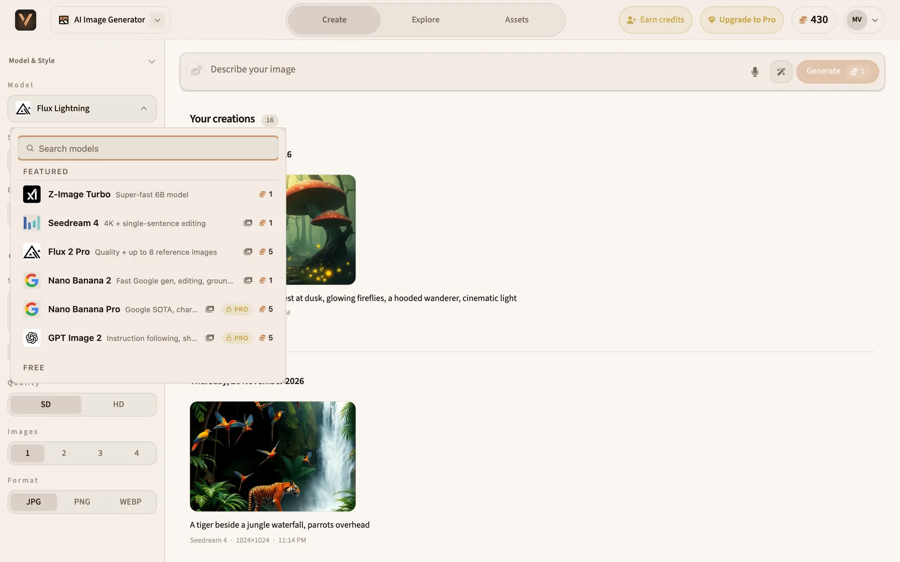
       <b>Model picker.</b> Cost shown per model; six premium models are Pro-gated.
    </td>
    <td width="50%" valign="top">
      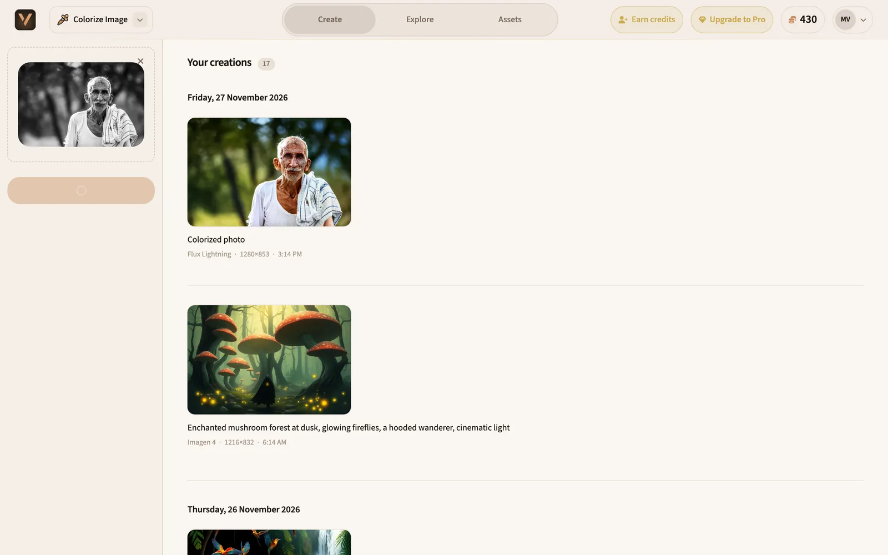
       <b>Photo tools.</b> Upscale (7 models), colorize, revive and remove background, chainable on any result.
    </td>
  </tr>
  <tr>
    <td width="50%" valign="top">
      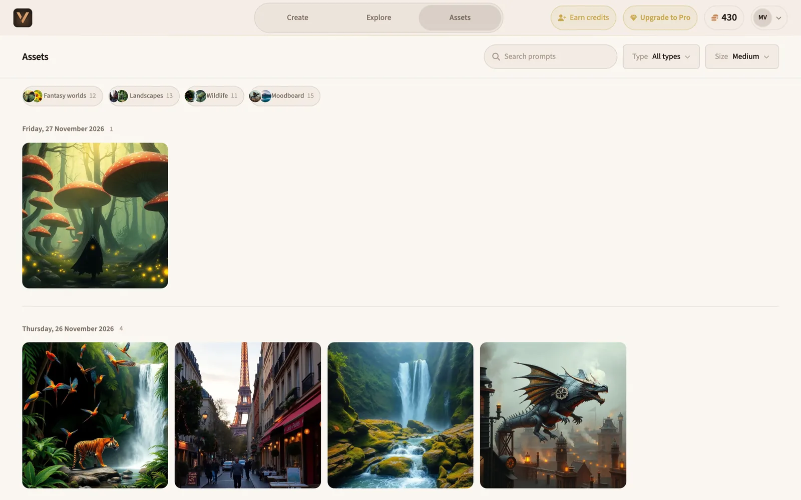
       <b>Assets.</b> History with favorites, collections, bulk delete and download.
    </td>
    <td width="50%" valign="top">
      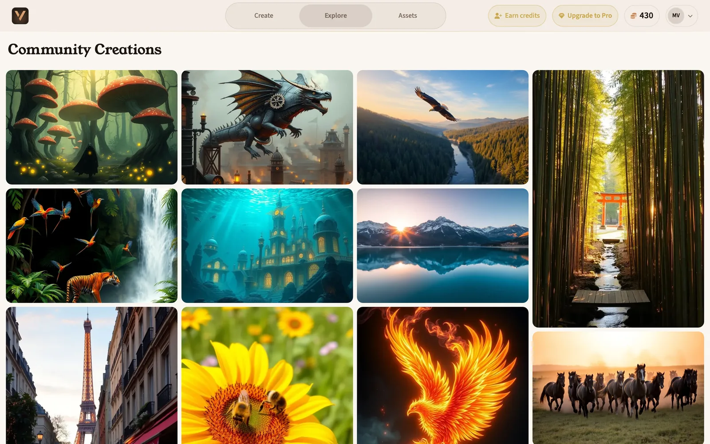
       <b>Explore.</b> A community feed and viewer. Pro generations stay private.
    </td>
  </tr>
  <tr>
    <td width="50%" valign="top">
      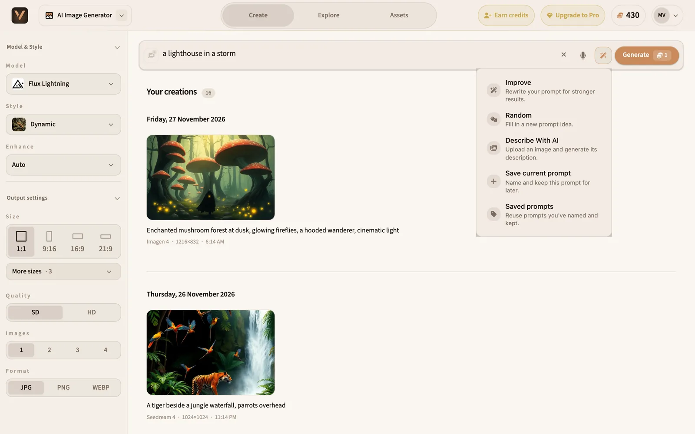
       <b>Prompt AI.</b> Improve, random and describe-image.
    </td>
    <td width="50%" valign="top">
      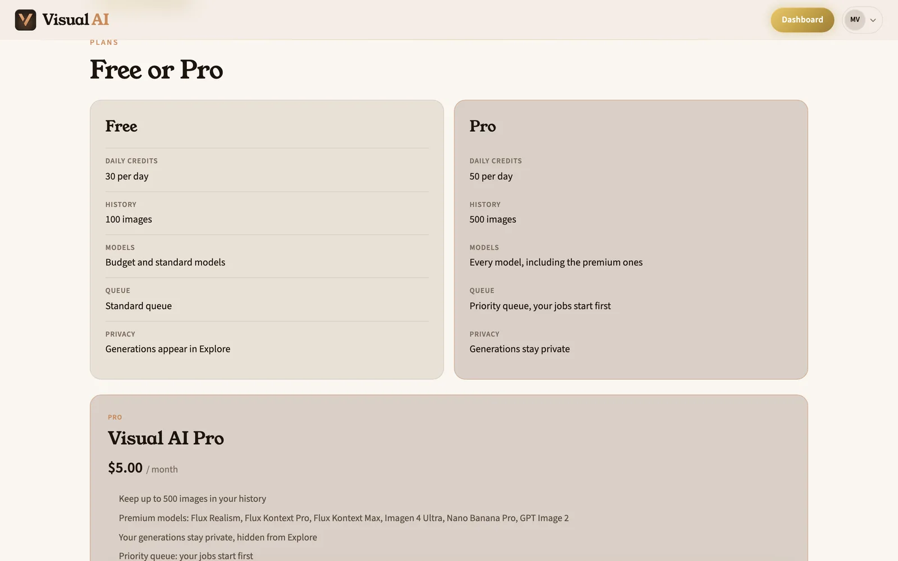
       <b>Credits and pricing.</b> Credit packs and a Pro subscription.
    </td>
  </tr>
</table>

### Photo tools

- **Upscale** with 7 models, including Clarity, Real-ESRGAN, Recraft and Google, plus premium Clarity Pro and Topaz.
- **Colorize** with DeOldify or DDColor.
- **Revive** old photos with GFPGAN or Restore Old Photos.
- **Remove background.**
- Chain any of these on a result without leaving the page.

### Prompt AI

- **Improve** and **Random** prompts use DeepSeek. **Describe image** uses Anthropic.
- Prompts sent to generation are moderated, and an auto-enhance picker is built in.
- **Voice prompt**: speech-to-text through xAI, capped at 60 seconds and rate-limited.
- Save prompts for reuse.

### Assets, Explore and sharing

- History with favorites, bulk delete and download, and collections. History holds up to 100 generations on free and 500 on Pro; once full, new results are shown but not saved until you free up space.
- Explore is a community feed with a detail viewer. Pro generations are never published.
- Share through the Web Share API, with copy-link as a fallback.

### Credits and pricing

- 30 credits on signup, plus daily credits that reset at 00:00 UTC: 30 on free, 50 on Pro.
- Referral bonus of 30 credits for both sides.
- INR credit packs of 200, 450, 960 and 2000 credits, with up to 30% savings on larger packs.
- Pro at $5/month through [Dodo Payments](https://dodopayments.com), shown in local currency using cached exchange rates. Pro adds a priority queue, private generations, premium models and a larger history.
- Credits are deducted only when a generation succeeds.

### Feedback system

Ask for feedback at the right moment, then triage it in-app.

<table align="center">
  <tr>
    <td width="50%" valign="top">
      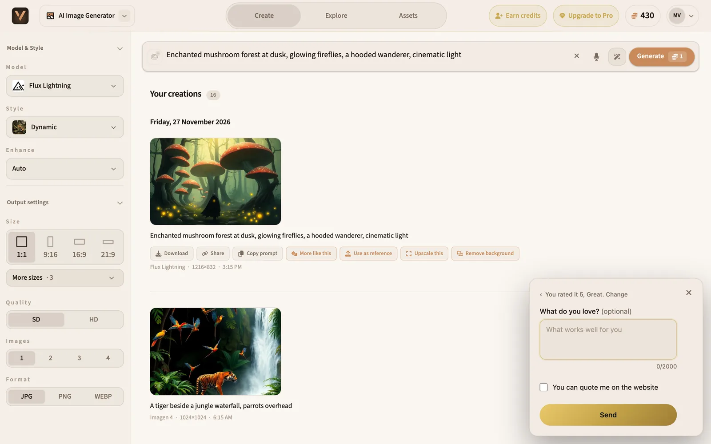
       <b>Contextual popup.</b> A non-blocking 1-5 rating card after a generation or download.
    </td>
    <td width="50%" valign="top">
      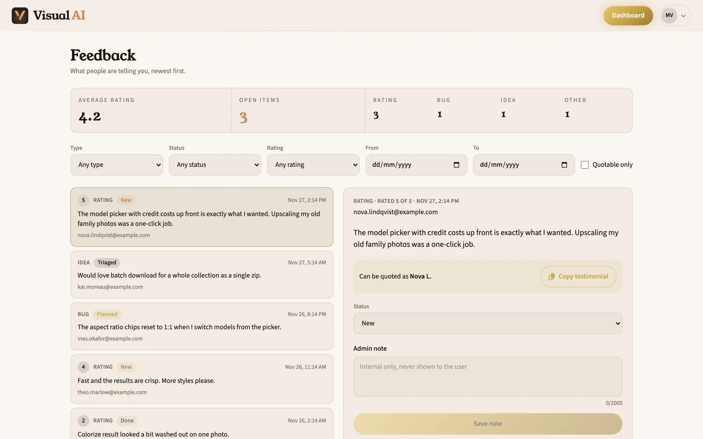
       <b>Admin triage.</b> Filters, status, notes and a summary strip at <code>/admin/feedback</code>.
    </td>
  </tr>
</table>

- **Smart timing.** The server decides eligibility: not in the first session, at least 3 successful generations (or a download), and a 30-day cooldown. The prompt is claimed atomically, so multiple tabs never double-prompt.
- **Follow-up by sentiment.** Low ratings ask what went wrong, high ratings ask what you love and offer an opt-in "you can quote me" testimonial.
- **Send feedback** lives in the user menu for bugs, ideas and other notes. Route, last model, plan, app version, browser and viewport are attached automatically.
- **Admin triage** at `/admin/feedback`, limited to configured admin user IDs: filter by type, status, rating and date, set status, add notes and copy consented testimonials.
- **Email alerts and a weekly digest** are optional and default to log-only, so nothing is sent unless explicitly enabled.

Also included: a What's New intro and tour, light and dark themes, keyboard shortcuts in the studio and a model `/compare` page.

## Tech stack

Bun workspaces monorepo: `apps/web`, `apps/api`, `packages/shared`, `packages/email`.

**Frontend**

- [Vue 3](https://vuejs.org) with [Pinia](https://pinia.vuejs.org) and vue-router – app framework and state
- [Tailwind CSS 3](https://tailwindcss.com) (`tw-` prefix) – styling
- [GSAP](https://gsap.com) and [Lenis](https://lenis.darkroom.engineering) – motion and smooth scroll
- [vite-plus](https://www.npmjs.com/package/vite-plus) – build, lint and test tooling

**Backend**

- [Express 4](https://expressjs.com) – HTTP API
- [MongoDB](https://www.mongodb.com) with Mongoose 8 – users, generations, feedback
- [BullMQ](https://bullmq.io) and [Redis](https://redis.io) (ioredis) – job queue and live progress
- [zod](https://zod.dev) in `packages/shared` – one validation source for web and API

**Services**

- [Replicate](https://replicate.com) – image models
- [Cloudinary](https://cloudinary.com) – image storage and delivery
- [Clerk](https://clerk.com) – authentication
- [Dodo Payments](https://dodopayments.com) – subscriptions and credit packs
- [Resend](https://resend.com) and React Email – transactional email
- [Vercel AI SDK](https://ai-sdk.dev) – DeepSeek and Anthropic prompt tools

**Quality and hosting**

- [Vitest](https://vitest.dev) and [Playwright](https://playwright.dev) – unit and e2e tests
- GitHub Actions – CI
- Self-hosted VPS with nginx, and Docker Compose for the API and Redis

## Architecture

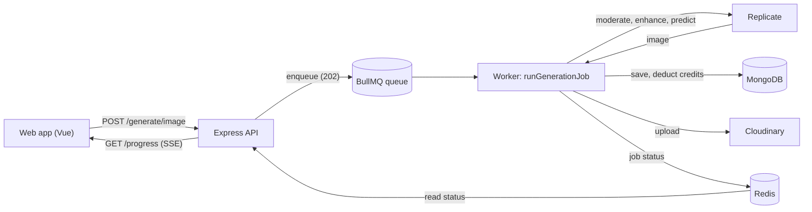

1. The web app posts to `/generate/image`. The API accepts the job and returns `202`; the worker maps the request onto the model's inputs from the shared registry.
2. BullMQ hands the job to a worker (Pro jobs get priority). It runs the moderation and prompt-enhance pipeline and calls Replicate.
3. The result is saved to MongoDB, credits are deducted atomically (daily credits first), and the image is uploaded to Cloudinary. A failed generation costs nothing.
4. Job status is written to Redis. The API's `GET /progress` streams it over SSE and the web app listens with `useEventSource`.

## Notable engineering decisions

- **One model registry.** `packages/shared` drives cost, Pro gating and input mapping for every model, and a script checks the model docs against it.
- **Mock-only paid APIs in tests.** A fake Replicate client serves e2e users, and the Playwright paid-call guard fails any un-stubbed paid request.
- **Safe payments.** Webhooks are idempotent and order-safe behind a provider abstraction, with cached exchange rates and geo-based currency.
- **One Pro entitlement function**, mirrored by the daily-credit cron filter so the two cannot drift.
- **Prerendered marketing routes** ship with JSON-LD for SEO.
- **Observability.** Structured pino logs and health checks.

## Roadmap

Upcoming: a **media studio** that extends the app beyond images. Each feature is planned to show its credit cost before you generate.

- [ ] Song studio
- [ ] Music generation
- [ ] Text to speech
- [ ] Video generation
- [ ] Tools: image watermark, video watermark, autocaption and sketch-to-image

## Contact

- GitHub: [@deepakkumardewani](https://github.com/deepakkumardewani)
- Questions or feedback: the app's [contact page](https://visual-ai.app/contact)

---

  © Deepak Dewani. All rights reserved. · <a href="docs/">Docs</a>

